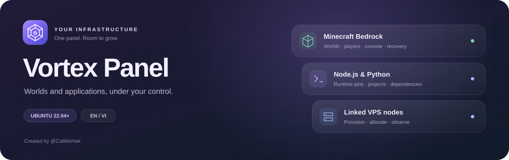

<p align="center"></p>

# Vortex Panel

[English](../README.md) · [Cài đặt](INSTALL.md) · [Node.js/Python](applications.md) · [Kết nối VPS](NODES.md)

Vortex Panel quản lý **Minecraft Bedrock, ứng dụng Node.js và Python** trên Ubuntu qua một workspace chung. Giao diện có sáng/tối, hỗ trợ máy tính/điện thoại và hai ngôn ngữ **EN/VI**, mặc định English. Tác giả: **@hovansi**.

## Cài bằng một lệnh

Trên VPS **Ubuntu 22.04+ x86_64**, có systemd và quyền sudo/root:

```bash
curl --proto '=https' --tlsv1.2 -fsSL https://github.com/hovansi/vortex-panel/releases/latest/download/install.sh | sudo bash
```

Installer tải release ổn định mới nhất, kiểm tra checksum/archive, cài dependency và dịch vụ. Bản cài mới tự chuẩn bị HTTPS theo IP công khai; kết thúc sẽ in URL và hướng dẫn tạo Admin bằng setup token riêng. Không có mật khẩu `admin` dùng chung.

HTTPS theo IP tự yêu cầu chứng chỉ công khai từ Let’s Encrypt và cài timer gia hạn. Cần mở TCP 80/443 chiều vào. Thao tác tự động tạo tài khoản ACME riêng không kèm email và chấp nhận thỏa thuận của CA; dùng `--self-signed` nếu muốn giữ chứng chỉ tự ký. Khi cấp chứng chỉ thất bại, HTTPS hiện có được giữ và cảnh báo còn được hiển thị đúng. Xem [quản lý HTTPS](HTTPS.md).

Chứng chỉ IP công khai có hạn **sáu ngày**; Vortex kiểm tra gia hạn mỗi sáu giờ và xác minh chứng chỉ đang phục vụ sau khi NGINX reload. Chứng chỉ tự ký dự phòng có hạn 365 ngày và vẫn cần quyết định tin cậy riêng. Cập nhật source trong panel giữ nguyên cấu hình truy cập. Múi giờ VPS, trạng thái phục hồi sau crash và [cấu hình mạng có thể khôi phục](NETWORK-TUNING.md) có trong phần quản trị; không thay đổi phiên bản runtime đã ghim của server.

Lệnh mặc định bật quyền quản trị host root cho bản cài mới. Ứng dụng Node.js/Python vẫn chạy bằng tài khoản riêng không có quyền root, trong sandbox. Bản nâng cấp giữ chế độ dịch vụ và cấu hình truy cập đã có. Installer dừng khi gặp dịch vụ web không thuộc quyền quản lý hoặc cổng xung đột; firewall nhà cung cấp/NAT cần cho phép truy cập phù hợp. Xem [chi tiết cài đặt, tùy chọn và cập nhật](INSTALL.md).

## Các công cụ chính

| Nhóm | Khả năng |
| --- | --- |
| Minecraft Bedrock | Catalog Stable/Preview và bản cũ có tìm kiếm; tự đọc gamerule đã lưu; tác động người chơi; add-on và thứ tự ưu tiên; thử nghiệm có backup trước khi đổi; xuất world đang chạy qua snapshot native |
| Node.js/Python | Tự tra bản ổn định mới nhất khi tạo rồi ghim phiên bản; entry file/npm script/module; cài thư viện; xem project; biến môi trường bí mật |
| Tệp và sao lưu | Upload/download, editor chống ghi đè xung đột, copy/move/rename, nén/giải nén, backup, retention và restore |
| Nhận diện máy chủ | Ảnh bìa, biểu tượng, miêu tả và màu chủ đạo cho thẻ/workspace; nội dung danh sách Bedrock hỗ trợ mã màu § được lưu riêng |
| Tài nguyên | CPU/RAM dùng chung hoặc giới hạn riêng; volume lưu trữ; số liệu CPU/RAM/đĩa/RX-TX; cấp cổng trống tự động theo VPS |
| Nhiều VPS | Nhập SSH trong panel để cài worker, xác minh agent, chọn VPS khi tạo server, theo dõi kết nối và bảo trì |
| Vận hành | Lịch có lệnh tùy chọn trước backup/restart, kết quả gửi lệnh rõ ràng, lịch sử có giới hạn, popup tiến trình và ID, firewall theo server, quyền Admin/Operator/Viewer, TOTP và mã khôi phục |
| Cập nhật panel | Xác minh release ổn định chính thức, cập nhật VPS phụ trước và panel chính cuối cùng, chỉ thay source/dependency của panel và agent, có kiểm chứng từng VPS và khôi phục yêu cầu bị gián đoạn |

Runtime của server cũ giữ nguyên; tạo ứng dụng mới không tự nâng cấp ứng dụng đang có. CPU/RAM là mức trần sử dụng, không phải cam kết tài nguyên vật lý. VPS chạy panel giữ lại 10% ngân sách; worker dùng dung lượng hiệu dụng, vẫn phải qua kiểm tra RAM/đĩa và năng lực thực tế.

Gamerule được Bedrock lưu trong world và giữ nguyên sau khi restart bình thường; panel tự đọc lại, không kích hoạt lại mù quáng. Có thể xem add-on/cấu hình stack khi server chạy, nhập pack chưa dùng và xuất world online. Có thể xóa online pack tùy chỉnh đã xác minh không dùng bởi tiến trình sẵn sàng và mọi world. Bật/tắt pack, đổi thứ tự ưu tiên hoặc sửa thử nghiệm cần dừng Bedrock để thay registration/metadata an toàn. Thử nghiệm được backup đã kiểm toàn vẹn trước khi ghi; xem [quản lý world](WORLDS.md).

## Dữ liệu và nâng cấp

Cập nhật thường xuyên tại **Cài đặt → Quản trị panel → Kiểm tra cập nhật**. Dừng mọi server và chờ tác vụ đang chạy hoàn tất trước; updater không tự dừng server của bạn. Hệ thống xác minh source và dependency của release chính thức, cập nhật từng VPS phụ, kiểm chứng qua SSH mới đã ghim khóa, rồi mới khởi động lại panel chính. Tài khoản, dữ liệu server/world/backup, cổng, giới hạn tài nguyên và phiên bản Minecraft/Node.js/Python đã ghim được giữ nguyên; không chạy nâng cấp package hệ điều hành.

Agent 0.19.x chưa có giao thức khóa tác vụ cho updater cần nâng cấp bảo trì một lần bằng installer tương ứng trước khi dùng cập nhật trong panel. Installer đầy đủ vẫn là luồng bảo trì riêng và có thể khởi động lại workload cục bộ. Sao lưu dữ liệu, khóa mã hóa, environment và chứng chỉ ra ngoài VPS trước khi nâng cấp. Rollback source không khôi phục world/dữ liệu ứng dụng; thay đổi metadata không tương thích giữ trạng thái chưa xác minh cùng bản chụp riêng để xử lý, không ghi đè database mù quáng. Xem [quy trình cập nhật và khôi phục](PANEL-UPDATES.md).

Mở server → **Giao diện** để tải hoặc bỏ ảnh bìa/biểu tượng, sửa miêu tả và màu chủ đạo. Đây là giao diện trong Vortex. Ảnh server đối tác trong danh sách Minecraft do Minecraft quản lý; upload ảnh vào panel không thêm ảnh vào mục server Bedrock thông thường. Với Bedrock, mục nội dung danh sách sửa `server-name` thực tế, hỗ trợ mã màu § và áp dụng khi khởi động server lần sau. Xem [giới hạn và lưu ảnh](SERVER-APPEARANCE.md).

Lịch backup/restart có thể lưu một lệnh chạy trước tác vụ, ví dụ `say §bA backup is about to begin.§r`. Ô lệnh giữ nguyên khi mở lại chỉnh sửa; lệnh cũ đã bị bản trước bỏ khỏi dữ liệu cần nhập lại một lần. Kết quả phân biệt đã gửi, native xác nhận, bị từ chối và chưa xác minh; không suy diễn rằng mọi người chơi đã nhận thông báo. Xem [lịch và kết quả lệnh](OPERATIONS.md#schedules-and-command-results).

Thao tác tệp và backup của Node.js/Python yêu cầu dừng ứng dụng. Bedrock có quy trình snapshot online riêng. Giới hạn dung lượng/định dạng nằm trong từng tài liệu; không nên dùng source ZIP thay cho bản sao lưu dữ liệu.

- [Cài đặt và cập nhật](INSTALL.md)
- [Quản lý ứng dụng](applications.md)
- [Nodes và SSH tự cài](NODE-PROVISIONING.md)
- [World và khôi phục](WORLDS.md)
- [Vận hành và snapshot toàn panel](OPERATIONS.md)
- [Cập nhật panel và VPS liên kết](PANEL-UPDATES.md)
- [Ảnh bìa, biểu tượng và nội dung Bedrock](SERVER-APPEARANCE.md)
- [API](API.md)
- [Nguồn và giấy phép bên thứ ba](THIRD_PARTY.md)

## Chạy từ source đã kiểm tra

Môi trường vận hành hỗ trợ là Ubuntu 22.04+ x86_64, Node.js 22 trở lên:

```bash
npm ci
npm run check
npm start
```

Dùng setup token riêng được in trong terminal để tạo Admin đầu tiên. Mặc định ứng dụng lắng nghe tại `127.0.0.1:3000`; xem [hướng dẫn cài đặt](INSTALL.md) để có systemd và HTTPS. Source công khai và ZIP phát hành chỉ gồm runtime, installer, script đóng gói và tài liệu vận hành. Công cụ kiểm thử nội bộ, dữ liệu runtime và thông tin riêng không được đóng gói.

Báo lỗi tại [GitHub Issues](https://github.com/hovansi/vortex-panel/issues), kèm phiên bản panel/Ubuntu và log đã che thông tin riêng. Không đăng mật khẩu, token, cookie hoặc tệp bí mật vào issue công khai.

## Tên dịch vụ và nâng cấp bố cục cũ

VPS chính mặc định hiển thị **Vortex Panel**. Dịch vụ là `vortex-panel.service`, source ở `/opt/vortex-panel`, dữ liệu mặc định ở `/var/lib/vortex-panel`, cấu hình ở `/etc/vortex-panel.env` và tài khoản dịch vụ riêng là `vortex-panel`. Installer chuyển bố cục cũ `bedrock-panel` khi đã dừng dịch vụ, kiểm tra volume và tài khoản ứng dụng, rồi tạo bản sao đầy đủ dữ liệu riêng tư trước khi đổi tên. `DATA_DIR` tùy chỉnh đã khai báo được giữ nguyên. Bản sao và biên nhận rollback lưu riêng cho root dưới `/var/backups/vortex-panel/migration-*/`. Mount không rõ chủ sở hữu, DATA_DIR mặc định là mountpoint, hoặc thao tác tạo tài khoản/build chưa hoàn tất sẽ bị chặn kèm hướng dẫn xử lý. Xem [hướng dẫn migration](INSTALL.md#legacy-layout-migration).

Manifest riêng tư `/etc/vortex-panel/install-manifest.json` ghi baseline package/manual-mark trước cài mới và chỉ xác nhận thay đổi thuộc Vortex. Bản cài cũ không có baseline vẫn được đánh dấu không rõ trạng thái trước cài; không tuyên bố khôi phục toàn bộ VPS về trạng thái chưa từng cài.
